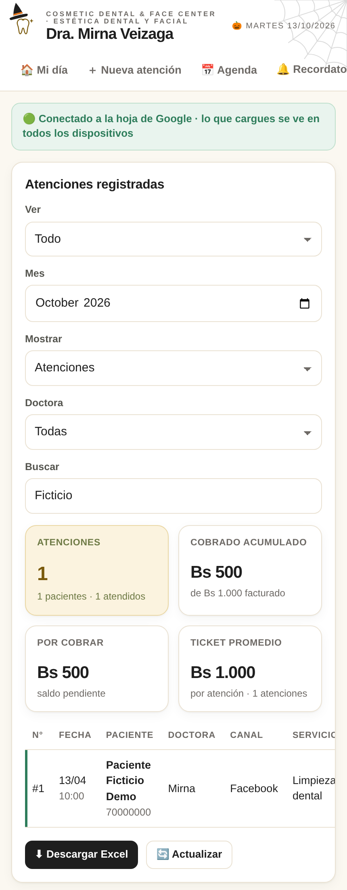
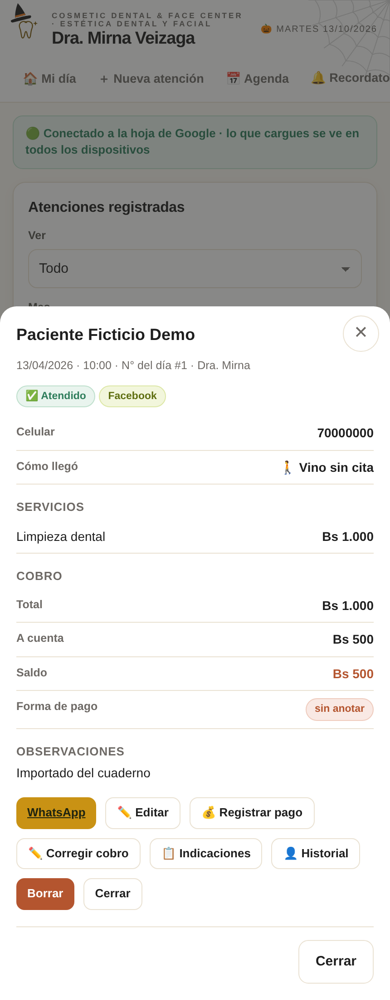
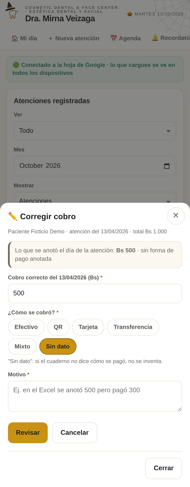
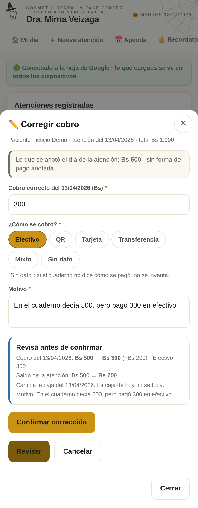
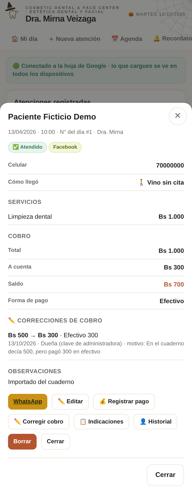

# Guía rápida: Corregir cobro

Sirve para arreglar un cobro mal anotado, aunque sea de hace meses o venga de un cuaderno importado. **No es un pago nuevo**: cambia lo que entró el día de esa atención. La caja de hoy no se toca.

- **Quién puede usarlo.** En Cosmetic, la dueña y recepción. En Spadental, solo la dueña.
- **Clave de fábrica.** Con la clave que traía el panel de fábrica no se puede corregir. Hay que cambiarla primero en Ajustes.
- **Conexión.** Necesita internet: el servidor controla cada corrección y la guarda.

Las capturas son de prueba, con un paciente ficticio.

## 1. Abrir la atención antigua

En **📋 Atenciones**, elegí **Ver: Todo** y buscá al paciente. Tocá la fila de la atención.

En la ficha de la atención está el botón **✏️ Corregir cobro**.

## 2. Escribir el cobro correcto y el motivo

Arriba se ve lo que se anotó ese día.

1. Escribí cuánto se cobró de verdad ese día. Puede ser más, menos o 0.
2. Elegí cómo se cobró. Si el cuaderno no lo dice, elegí **Sin dato**: no se inventa una forma de pago.
3. Escribí el motivo. Es obligatorio.

Lo que se pagó con **saldo a favor** y los **pagos posteriores** no se tocan acá.

## 3. Revisar y confirmar

Tocá **Revisar**. Antes de confirmar se ve:

- el cobro antes y después, con la diferencia;
- cómo queda el saldo de la atención;
- qué caja cambia (la del día de la atención, no la de hoy).

Si está bien, tocá **Confirmar corrección**. Un doble clic no corrige dos veces. Si se corta internet, volvé a confirmar: la corrección se aplica una sola vez.

## 4. Verificar saldo e historial

La ficha muestra el cobro y el saldo nuevos. Debajo aparece **✏️ Correcciones de cobro** con:

- el monto antes y después;
- la fecha de la corrección;
- quién la hizo;
- el motivo.

Con la clave compartida de recepción figura como "Recepción (clave compartida del equipo)", no a nombre de una persona.

En la Caja, esa atención lleva la marca **✏️ corregido**.

La planilla de Google guarda además una copia de cada corrección en la hoja **_Correcciones**. Ninguna otra acción del panel la toca.

## Si algo no deja corregir

| Mensaje | Qué hacer |
|---|---|
| "Mientras tanto otro equipo cambió este cobro" | Otro equipo cobró o corrigió esa atención mientras tanto. El panel la muestra actualizada: revisala y corregí de nuevo si hace falta. |
| "Con la clave de fábrica no se corrigen cobros" | Cambiá la clave en Ajustes y volvé a entrar. |
| "Falta actualizar el Apps Script" | Todavía no se pegó el script nuevo en Google. |
| "Se pagaría más de lo que debía" | El cobro no puede superar el total menos el descuento. |
| Franja arriba: "volvé a escribir tu clave" | La sesión venció (dura 30 minutos sin uso). Escribí tu clave y sigue guardando. |
